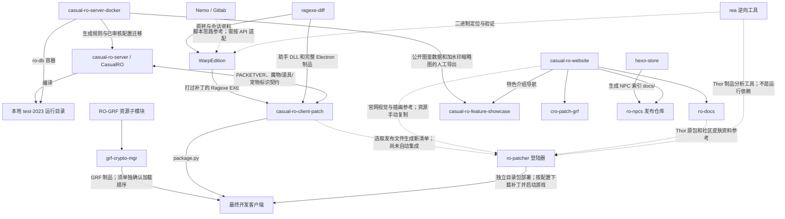

# 随缘仙境仓库关系索引

记录日期：2026-10-21（Asia/Shanghai）。范围是本次开发对话实际涉及的仓库和本机路径，不是所有 RO 项目的完整清单。仓库路径、origin、当前分支及关键脚本已从本机核对；网站地址是项目约定入口，本次没有联网验证 DNS、线上内容或 Pages 设置。

需要改东西时，先看下面的定位表，再查 [开发与发布流程](docs/development-and-release.md) 或 [网站与 NPC 索引](docs/websites.md)、[Warp、助手与逆向工具链](docs/client-toolchain.md)、[登陆器、主题与补丁更新](docs/launcher-and-updates.md)。可供工具读取的路径和关系见 [repos.json](repos.json)。

## 仓库速查

除特别标注的 Nemo（`D:\workspace\Gitlab\Nemo`）外，下表本地仓库均位于 `D:\workspace\Github`，本地目录名与仓库名相同。

|仓库|负责什么|关键入口或产物|
|---|---|---|
|[casual-ro-server](https://github.com/Casual-Ragnarok/casual-ro-server)|服务端 C++ 源码、特性分支、原生数据库及 NPC|实际开发引擎在 `CasualRO/`；`FEATURE-011-Pokemon`；`codex/test-2023`|
|[casual-ro-server-docker](https://github.com/Casual-Ragnarok/casual-ro-server-docker)|Docker 部署、覆盖配置、自定义数据和开发辅助工具|`docker-compose.yml`、`covers/`、`customs/`、`dev/py/pokemon/`|
|[casual-ro-client-patch](https://github.com/Casual-Ragnarok/casual-ro-client-patch)|客户端补丁装配与发布|`py/package.py`、`Ragexe/`、`data/`、`System/`、`Assistant/`|
|[ro-patcher](https://github.com/Casual-Ragnarok/ro-patcher)|玩家启动游戏前使用的 Electron 更新登陆器；独立于 RO 助手|`src/main.cjs`、`config.example.json`、`themes/`、`scripts/make-patch.cjs`；完整目录包 `dist/win-unpacked`|
|[ragexe-diff](https://github.com/Casual-Ragnarok/ragexe-diff)|原胚、Diff 会话、密钥检查与 RO 助手开发|`diff/Warp/`；`py/packet/packet_keys.py`；`assistant/` 的 DLL 与 Electron UI|
|[WarpEdition](https://github.com/Casual-Ragnarok/WarpEdition)|当前 Warp 补丁脚本适配、逐原胚测试和支持矩阵|`Scripts/`、`Patches/`、`Sessions/Clients/`、`Docs/Patch-Support/`|
|[rea](https://github.com/EXP-Tools/rea)|分析 EXE 的逆向工具工程；辅助定位和验证补丁|上游 `morluto/rea`；不是 RO 客户端或助手运行依赖|
|[Nemo](https://gitlab.com/4144/Nemo)|另一套 Diff 工具和补丁脚本参考|本地 `D:\workspace\Gitlab\Nemo`；`Patches/`、`NEMO.exe`|
|[grf-crypto-mgr](https://github.com/Casual-Ragnarok/grf-crypto-mgr)|GRF 图档整理、合并、加密与资源构建|`auto_merge_grf.py`；`RO-GRF/` 资源子模块|
|[casual-ro-website](https://github.com/Casual-Ragnarok/casual-ro-website)|官网首页与导航入口|`casualro.top`，`tools/build.mjs`|
|[casual-ro-feature-showcase](https://github.com/Casual-Ragnarok/casual-ro-feature-showcase)|玩家向特色介绍、PokeWorld 玩法介绍及图鉴|`feature.casualro.top`；`pokeworld/`、`pokeworld/pokedex/`|
|[ro-docs](https://github.com/Casual-Ragnarok/ro-docs)|文档、资料与工具目录|`docs.casualro.top`，有效站点内容主要在 `docs/`|
|[cro-patch-grf](https://github.com/Casual-Ragnarok/cro-patch-grf)|玩家访问的 GRF/客户端补丁下载说明页|`grf.casualro.top`，不等同于 GRF 资源构建工程|
|[hexo-store](https://github.com/Casual-Ragnarok/hexo-store)|商城内容、NPC 模块资料与 NPC 索引生成|`py/gen_npc_list.py`、`tpl/summary/html/`、Hexo 发布流程|
|[ro-npcs](https://github.com/Casual-Ragnarok/ro-npcs)|NPC 索引的静态发布副本|本地 origin 指向 Casual-Ragnarok；实际已使用的另一发布目标是 [EHakker/ro-npcs](https://github.com/EHakker/ro-npcs)，详见网站文档|
|[ro-repo-relation](https://github.com/Casual-Ragnarok/ro-repo-relation)|本索引：记录仓库职责、依赖和操作入口|本仓库不承载游戏代码或发布制品|

## 关系图

箭头说明依赖或制品流向，不代表所有步骤已经自动化。

## 要改什么，应该去哪里

|需求|首选仓库与后续动作|
|---|---|
|修改口袋妖怪捕获、宠物技能、进化或服务端宏|`casual-ro-server`；生成工具在 `casual-ro-server-docker/dev/py/pokemon`，同步前须审查差异|
|修改服务端镜像部署、挂载或覆盖配置|`casual-ro-server-docker`；本次本地功能测试不需要改服务端镜像|
|修改客户端名称、宠物合成界面、道具说明|`casual-ro-client-patch` 的 Lua/LUB 等配置，然后 `py/package.py`|
|修改客户端 EXE 补丁选项|优先 `WarpEdition/Scripts` 与 `Patches`；原胚保存在 `ragexe-diff/diff/Warp`；生成结果放回客户端 `Ragexe/`，发布并同步服务端 MD5 白名单|
|查看每个原胚哪些补丁可用|`WarpEdition/Docs/Patch-Support/README.md` 与 `matrix.csv`；失败代表当前脚本未通过，不等于不能适配|
|提取最终 EXE 的三把封包密钥、核对文件 MD5|`ragexe-diff/py/packet/packet_keys.py`；MD5 是最终文件摘要，不是第四把封包密钥|
|分析原胚或参考另一套 Diff 实现|`rea` 辅助逆向；`D:\workspace\Gitlab\Nemo/Patches` 参考实现；最终修改落到目标工具的脚本|
|修改 RO 助手逻辑或 UI|`ragexe-diff/assistant`；构建制品复制到客户端 `Assistant/runtime`，更新来源与校验清单|
|修改启动前的更新界面、公告或主题|`ro-patcher`；集中配置在安装目录 `ro-patcher/config.json`，主题在 `ro-patcher/themes/`；不是 `ragexe-diff/assistant`|
|发布给登陆器自动下载的补丁|先准备客户端变更文件，再用 `ro-patcher/scripts/make-patch.cjs` 生成清单，上传文件及清单到明确配置的 HTTP(S) 地址；尚未与 `package.py` 自动接通|
|合并/替换 SPR、ACT、地图或装备图档|`grf-crypto-mgr` 与其 `RO-GRF` 资源；重新构建并确认 `data.ini`|
|修改 PokeWorld 宣传或公开图鉴|`casual-ro-feature-showcase`；不要把服务端数据库或原始 GRF 放进去|
|修改官网首页/导航|`casual-ro-website`|
|修改文档站菜单/页尾|`ro-docs/docs`|
|修改 GRF 下载页菜单/页尾|`cro-patch-grf`|
|修改 NPC 索引菜单/页尾|先改 `hexo-store/tpl/summary/html`，生成后发布到正确的 `ro-npcs`，不要只改生成副本|
|修改商城自身页尾或微信悬浮二维码|`hexo-store` 的商城主题；不要把 NPC 索引页尾直接套到商城|

## 本项目已经明确的约定

- 后续服务端源码开发按现有约定在 `casual-ro-server` 中使用分支。本机还保留此前已创建的 `casual-ro-server-custom-commands` 工作区，它属于同一个 Git 仓库，不是新项目；详见工具链文档。本地测试不改 Docker 服务端镜像。
- 特性源码受宏开关保护，尽量少改引擎，方便后续合并。
- `FEATURE-008` 是 AutoAttack、`FEATURE-009` 是 BotPlayer、`FEATURE-010` 是 CustomCommands；口袋妖怪使用 `FEATURE-011-Pokemon`，主宏 `CasualRO_Pokemon`。
- `codex/test-2023` 是实际已有的测试分支名，口头说的 test-2023 指它，不是另一个名为 test-2023 的分支。
- 不把临时 `.before-*` 备份混入客户端源码或发布包；发布备份放在专用临时目录。
- 仓库内容发生修改不等于已经提交、推送或发布。本索引不承诺这些状态；操作前看 `git status`、分支和对应构建记录。
- `ro-patcher` 首版已有文件替换、完整 GRF 下载替换和主题切换；Thor 皮肤导入、`.thor` 解包、GRF 内部合并、网盘解析和自身升级尚未实现。下载介绍页 `cro-patch-grf` 不等同于已配置的自动更新服务。
- 不记录 `.env` 内容、数据库密码、SSH 私钥、访问令牌或私人运行配置。

## 更新方式

新增仓库或调整构建/发布链时，同时更新本表、对应流程文档和 `repos.json`。分支和本地运行状态会变化，JSON 中的分支是记录日期的快照，执行操作前仍需重新确认。部分仓库 README/CNAME 保留旧域名，不能只根据旧说明判断当前入口。
