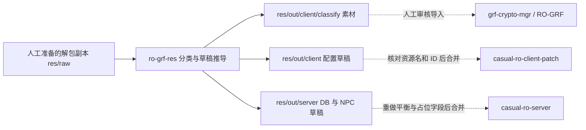

# GRF 资源分类与配置草稿推导

核对日期：2026-10-21（Asia/Shanghai）。仓库：[`Casual-Ragnarok/ro-grf-res`](https://github.com/Casual-Ragnarok/ro-grf-res)，本地 `D:\workspace\Github\ro-grf-res`；分支快照 `main`，源提交 `676bca185165cefc2f098d56b48f10d152529f38`。本次仅静态阅读源码，没有运行会移动或删除素材的分类任务，没有验证线上仓库或发布状态。

## 定位和边界

README 将它称为“RO GRF 图档资源配置逆向推导器”。实际入口读取已经解包的目录，依据 SPR/ACT、BMP、PAL、WAV 等配套文件及可选 iteminfo 识别素材类型，再生成资源分类结果与配置草稿。

它不直接解析或解密 GRF 容器，不是 EXE 逆向工具，不负责 GRF 合包、加密、客户端补丁发布或服务端启动。`ro-grf-res` 与 REA、`grf-crypto-mgr`、`package.py` 的职责不同；也不是此前口袋妖怪合并遗漏 cardbmp 的来源。

## 数据流与仓库关系

这些下游关系表示应交接的位置，并不表示三个仓库已经自动调用此工具。当前口袋妖怪专用合并、固定外观注册及平衡生成仍在 `casual-ro-server-docker/dev/py/pokemon/`，未接入本工具的分类入口。它可作为路径配套检查和分类规则的参考，不能替换当前外观注册表。

## 关键入口与实现

|入口或模块|作用与核对依据|
|---|---|
|`py/classify_grf.py`|主入口；顺序执行道具、魔物/宠物、角色模型分类，并读写 MD5 缓存；末尾明确要求人工合并和补全 TODO|
|`py/core/res_item.py`、`ex_head.py` 等|从 collection 图和可选 iteminfo 入手，按头饰、披风、武器、盾牌、一般道具等所需文件组合分类|
|`py/core/res_mob.py`、`ex_pet.py`、`ex_mob.py`|检索魔物资源名，先判定宠物配套是否齐全，再判定魔物；按起始编号顺序分配 ID|
|`py/bean/paths/`|封装种族、性别、职业、素材目录与文件名配套规则；`PetPath.pet_paths()` 要求 SPR、ACT 和英文 userinterface/illust 下的同名 BMP|
|`py/core/res_model.py`|分类发型、发色、身体和服色；以发型/颜色上限限制扫描|
|`py/utils/md5mgr.py`|缓存文件组内容摘要：单文件 MD5 排序拼接后再算 MD5，用来识别已处理的异名配套；不是图像相似度或语义识别|
|`py/utils/pokemgr.py`、`libs/pokename.csv`|加载全国编号译名表；`MobDB` 的 `-p` 分支仅从已有 `No.<编号>...` 资源名查名称，不会识别 PokeRO 错误流水号|
|`py/re_enname.py`|英文重命名辅助入口；当前实际调用道具分类，服务端/客户端配置保存调用被注释，也会进入移动/删除素材的分类逻辑；不应视为无副作用的预览命令|

## 输入、输出和参数

从仓库根目录运行，路径相对当前工作目录：

|位置|内容|
|---|---|
|`res/raw/`|已解包资源的工作副本；可包含 `data/` 树和 Lua 文本道具信息|
|`py/conf/vars.py`|输入/输出目录、编码、对照客户端、各配置输出位置|
|`py/conf/envm.py`|种族、性别、职业、装备类型等命名约定；必须与实际解包后的路径编码/名称一致|
|`EXIST_RES_DIR`|当前写死为 `R:/RO/客户端/随缘仙境-完整客户端`；执行前要核对，不应假定等于现在的开发客户端|
|`res/exist/md5.txt`|已处理资源组摘要缓存；会被读取和写回|
|`res/out/client/classify/`|分类后的 head、garment、weapon、shield、item、mob、pet、hair、body 素材|
|`res/out/client/data/...`、`System/`|外观池、jobname/npcidentity、iteminfo 等客户端草稿；宠物表还生成 `.PetNameTable`、`.PetIllustNameTable`、`.PetFoodTable` 等辅助片段，需人工并入实际 Lua 表|
|`res/out/server/db/`、`npc/`|道具/魔物/宠物数据库草稿、分类商店、魔物召唤测试脚本|

入口参数包括 `-l/--iteminfo`（默认 `iteminfo.lua`）、`-i/--itemid`（默认 2000000）、`-v/--viewid`（默认 2000）、`-m/--mobid`（默认 20000）、`-p/--poke`、`-a/--append` 和 `-r/--hairid`、`-c/--colorid`（均默认 10）。默认值只是旧工具的起点，不表示当前服务端中相应区间空闲；尤其不能覆盖现有 45000 段等固定口袋妖怪映射。

仓库声明的 Python 依赖见 `py/requirements.txt`（argparse、py-color-log）。准备好独立输入副本并核对上述路径、编码与 ID 范围后，可按该文件安装依赖并从根目录运行 `python py/classify_grf.py -h` 查看参数。这里不把实际分类命令写成无条件的一键操作。

## 为什么输出必须人工审核

1. **分类会修改输入副本。** `extract_*` 调用 `move_paths` 移走分类成功的配套文件，对被判定已存在或已处理的素材调用 `remove_paths` 删除；它不是只读扫描。原始解包目录、唯一素材副本及正式客户端不能直接作为工作输入。
2. **战斗数值是占位。** `py/bean/mob_db.py` 用 `random.randint` 生成等级、血量、经验、攻击和六维等；不能用于当前口袋妖怪的成长、种族值、四转或 BOSS 平衡。
3. **宠物配置未完成业务设计。** `pet_db.py` 包含 `TameItem: TODO`、默认波利蛋、Pet_Food 与固定 CaptureRate=3000 等草稿值；不能覆盖当前禁捕、进化、好感度技能和特殊形态规则。
4. **编号和资源名要另行核对。** 顺序分配不等于跨仓库无冲突分配；全国图鉴译名表也不校正外服原编号。旧的 ID 帮助范围不能代表新增高编号宠物支持状态。
5. **路径、编码和解析格式有约束。** 客户端文本默认 GBK、服务端 UTF-8；iteminfo 读取器依赖特定行格式和终止标记，不是通用 Lua 执行器，也不能直接当作 Lua 字节码解编译器。

## 当前值得借鉴的部分

- 将素材作为配套文件组处理，而非孤立复制 SPR 或 ACT。
- 分开维护 cardbmp 卡片图与 userinterface/illust 宠物立绘的路径和客户端引用。当前口袋妖怪已采用原包 Pokémon 字样卡片，同全国编号所有形态共用，不应恢复 PokeRO 插画优先。
- 分类素材与客户端/服务端草稿分目录输出，并使用人工审核作为进入正式仓库的边界。
- 用内容摘要识别重复文件组；若移植到现有流水线，应继续保留当前的 SHA256、外观 ID 稳定性与来源记录，不直接照搬随机数据库生成器。

后续构建和发布见 [开发与发布流程](development-and-release.md)；EXE 补丁与助手见 [客户端工具链](client-toolchain.md)。本次仅更新关系索引，没有修改或运行 `ro-grf-res` 源码，也没有导入图档或重新发布客户端。
