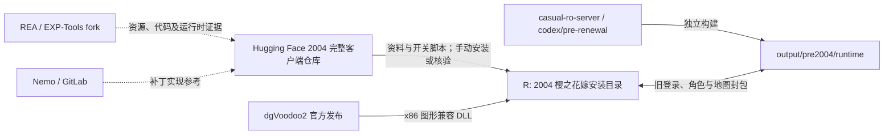

# 2004 樱之花嫁客户端与 PRE 服务端

核对日期：2026-10-21（Asia/Shanghai）。本次只核对本地仓库元数据、分支文件、安装脚本和当前 EXE 摘要，没有重新编译、启动服务、登录游戏或验证线上地址。下文运行验收属于 2026-10-17 的已有记录，不是实时状态。

## 各个位置分别保存什么

|项目或路径|职责与维护入口|
|---|---|
|`D:\workspace\ro\Cherry_Blossom_Bride_FullClient_2004`|Hugging Face 数据集 Git 仓库，origin 为 `git@hf.co:datasets/EXPM02/Cherry_Blossom_Bride_FullClient_2004`，当前 `main`；`client/` 保存完整客户端资料，`docs/` 保存适配记录，`tools/` 保存补丁开关及校验脚本|
|`R:\RO\04-GF\2004樱之花嫁`|实际安装和测试目录；不与数据仓库、客户端发布仓库自动同步|
|`D:\workspace\Github\casual-ro-server`|服务端源码仓库；2004 工作落在 `codex/pre-renewal`，主工作区当前为 `codex/test-2023`，执行命令前必须确认分支|
|`D:\workspace\Github\rea`|逆向分析工具；origin 是 EXP-Tools/rea，upstream 是 morluto/rea；分析目标 EXE，不是游戏运行依赖|
|`D:\workspace\Gitlab\Nemo`|4144/Nemo，当前 `master`；`Patches/SkipServiceSelect.qs`、`SkipLicenseScreen.qs`、`ReadDataFolderFirst.qs` 是本次参考的补丁规则，属于 GitLab 仓库|
|dgVoodoo2|外部图形兼容组件；本次来源为官方 `dege-diosg/dgVoodoo2` 的 v2.87.5 发布包；使用 x86 `DDraw.dll`、`D3DImm.dll` 和 `dgVoodoo.conf`，不是修改该项目源码|

数据仓库 README 将素材标为“20040427 完整简中客户端（CD 完整复刻）”；这不等同于 EXE 的唯一协议日期。服务端的 `PACKETVER=20040317` 是配套适配选择，不能仅凭数据集名、EXE 文件名或时间戳认定。



这条链与 `WarpEdition → casual-ro-client-patch → CasualRO-2023` 是两套工作流。没有证据表明旧客户端由现代 `package.py` 装配，或已接入 `ro-patcher` 更新清单；不要把旧 EXE 和兼容 DLL 无条件复制到现代客户端。

## 当前安装入口与客户端记录

实际脚本已经重命名；本次核对结果如下：

- `_开始游戏.cmd` 启动 `2004_Ragexe_20261017_patched.exe`，参数为 `1rag1 /account:clientinfo.xml`，工作目录为脚本所在目录。
- `_游戏设置.cmd` 启动原版 `Setup.exe`。两脚本均设置 `__COMPAT_LAYER=DWM8And16BitMitigation`。
- 当前加载入口是 `data\clientinfo.xml`。先前本会话使用的 `data\rea-local-login.xml` 是历史配置名，不应继续据此判断当前连接地址。
- 实际安装 EXE SHA-256 为 `a9167f216dba2c0d1e36bacc832fb8ccbac817eff8b06bb79d32cdde343c9b57`，与数据仓库补丁记录开头的“窗口光标同步版”相符。它已不是初次只修登录和 BGM 时的文件摘要。

权威维护资料：

- 数据仓库 `docs/Client-2004-Patch-Record.md` 与 `docs/client-2004-patches.json`：补丁、开关、字节与当前构建记录。Markdown 保留多段历史状态；不能只取其中某个“当前”段落，应对照实际摘要和 JSON 的 `current_build`。
- `tools/toggle-2004-server-select.py`：服务器选择开关；多个 `<connection>` 与“跳过服务器选择”是两回事。记录中的最新构建已开启选择；不要沿用本会话早期“固定第一条”的结论。
- `tools/toggle-2004-mouse.py`、`tools/toggle-2004-cursor-sync.py`：鼠标模式与窗口光标同步。光标扩展和 BGM 共用 `.text.VirtualSize` 管理，回退顺序按工具及记录执行，不能盲目叠加旧字节补丁。

旧版官网选择页、资源加载、显示兼容和 BGM 是不同问题：REA 曾确认资源可以从 `data.grf` 读取；最终图形兼容组件负责解决本机白屏；登录 BGM 曾因传入音量为 0 而静音，修复记录归入客户端补丁。不要以某个功能恢复推断联服协议已经兼容。

## 服务端分支、协议与构建链

`codex/pre-renewal` 分支现有 `docs/Pre-Renewal-2004-Compatibility.md` 记录：它基于 master 的 `fb70ec0ac23fca1e72102558e9cd7290b60d2ea8`，不包含 Bot 源码、工程或编译宏。`codex/pre-renewal-bot-backup-20261017` 保留迁移前历史，不能当作当前启动分支。

早期尝试曾使用 `bot-player/native-tests/start_pre.ps1`，只开 PRE 时仍按 20211117 协议编译。旧客户端发送 55 字节 `0x0064`，服务端却返回现代失败包 `0x083e` / 26 字节；切换 PRE 规则不等于切换通信协议。后续独立 2004 适配还修正了 106 字节角色记录和 10 字节普通物品记录，不能只改一个 PACKETVER 宏就认为完成。

**当前分支文件中的入口**（仅在确认已检出 `codex/pre-renewal` 后使用）：

```powershell
.\bin\build-pre2004.ps1
.\bin\start-pre2004.ps1
python .\bin\probe-legacy-login.py --expect legacy
```

|位置|用途|
|---|---|
|`bin/pre2004.props`|2004 协议构建参数|
|`output/pre2004/build/bin`|独立编译产物，避免覆盖 2023 或旧 Bot 的共享输出|
|`output/pre2004/runtime`|实际运行副本与日志；不是源码目录的自动链接|
|`output/pre2004/local.json`|本机启动定位配置；不在本索引记录其私人内容|
|`output/pre2004/rollback-runtime`|旧程序与运行配置的回退副本|

启动器按本机 Docker `ro-db` 检查角色离线后，再按完整路径识别并替换三服务；默认登录、角色、地图端口为 6900、6121、5121。它与 2023 测试服的默认端口重合，不代表可以同时启动两套。回退入口为 `bin/start-pre2004.ps1 -Rollback`，只回退程序，不自动回滚数据库；先阅读分支文档并确认角色离线。

数据仓库内同名 `docs/Pre-Renewal-2004-Compatibility.md` 还保留早期 `bot-player/build/pre2004` 流程。**服务端当前分支中的说明优先用于构建启动**，不要把数据仓库的历史镜像当作最新服务端脚本清单。

## 已有验证与尚需现场核对的内容

2026-10-17 的服务端分支记录称三端编译、监听与旧失败回包探针通过，且用户曾确认进入地图、打怪升级和重新登录物品正常。记录也区分了迁移 master 前后的验收范围：迁移后三端和探针已检查，游戏内流程仍需重新登录复核。

本次没有重复这些运行测试，不将历史结论扩展为当前在线状态或所有 2004 客户端均兼容。联服时仍需核对实际 EXE、加载 XML、分支/构建参数、角色/物品封包布局、世界资源和服务端日志。账号 `_M` / `_F` 是注册后缀，已有账号登录不应重复附加；这与协议版本是两个独立问题。

## REA 自身的上游与子模块

以下是工具工程自身的源码依赖，与 RO 安装目录、Nemo、dgVoodoo 不是同一种依赖。此列表来自 REA 当前 `.gitmodules`，不表示本次已检出、安装或验证运行：

|REA 子目录|上游|
|---|---|
|`third_party/jadx-headless-mcp`|`1013503897/jadx-headless-mcp`|
|`third_party/binwalk`|`ReFirmLabs/binwalk`|
|`third_party/unblob`|`onekey-sec/unblob`|
|`third_party/ghidra-nativeaot`|`Washi1337/ghidra-nativeaot`|
|`third_party/wakaru`|`pionxzh/wakaru`|

REA 子模块检出问题应在 REA 工程处理，不应通过替换 RO 客户端文件解决。分析工具可用也不代表所有原生反编译提供方均已配置；本次历史调查分别使用了 REA 的运行时证据和本机已有反汇编工具，不能混称为全部由 REA 反编译得到。
